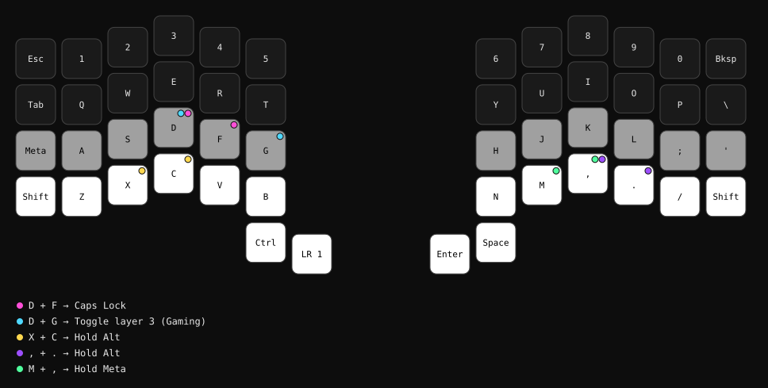
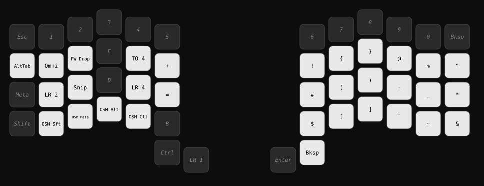
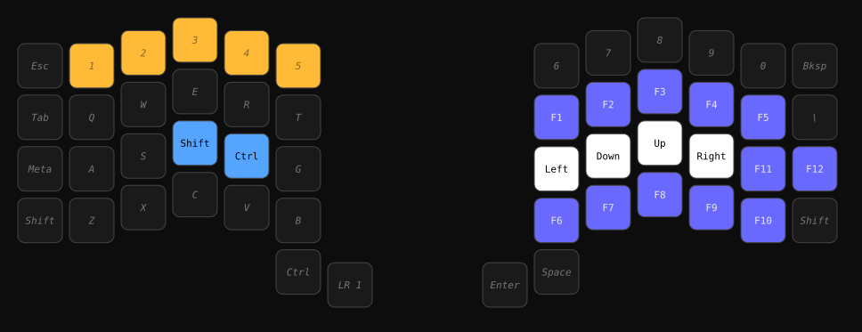
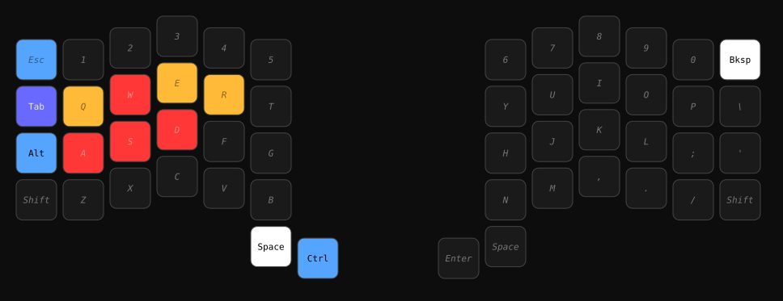
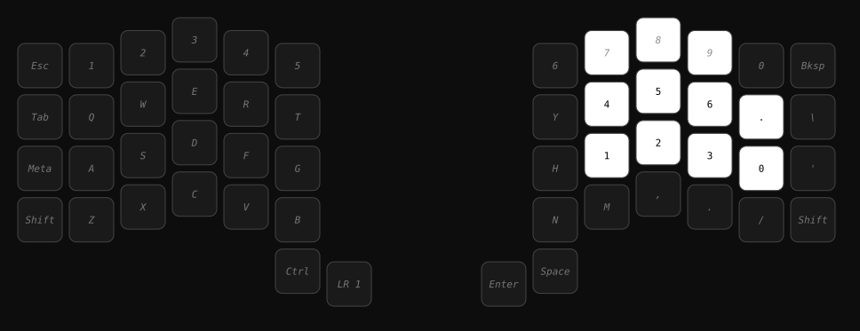

# voyager-keymap

Personal QMK keymap for my ZSA Voyager. Developed locally now — no more
round-tripping through Oryx's web configurator and re-downloading exports.

## Layers

5 layers:

- **0 — base**: standard QWERTY, with a real number row (1-0) on top,
  `Esc`/`Tab`/`Shift`/`Ctrl`/`GUI` as modifiers, `Backspace` in the unused
  top-right corner, and the left-thumb key holding **layer 1**.
- **1 — symbols** (hold left thumb): punctuation/symbols, a nested numpad on
  **layer 4** (hold the `MO(4)` key), one-shot mods (Shift/GUI/Alt/Ctrl —
  tap for one-shot, hold-and-type for a normal held modifier), an omnibar
  launcher shortcut, and **Alt-Tab**: hold the thumb, tap `Tab` to cycle,
  release to select.
- **2 — nav/function**: F-keys, arrow keys, left-hand Shift/Ctrl.
- **3 — gaming** (toggle with a `D`+`G` combo): left-hand-only by design
  (right hand stays on the mouse). WASD/QWER are highlighted but otherwise
  unchanged; the left-thumb key is real Ctrl that becomes Alt-Tab the moment
  you also tap `Tab` (see `GAME_CTL`/`GAME_TAB` in keymap.c); a standalone
  Alt and the layer-shift key live on the pinky's home column so the hand
  never has to leave its resting position.
- **4 — numpad** (nested inside layer 1, or toggle with `TG(4)`): numbers on
  the right hand.

Per-layer RGB lighting only lights keys that actually do something on that
layer — unused keys stay dark — using a small shared color palette (white =
plain key, light blue = modifier, light green = layer-switch, blue/orange =
symbols/function, teal = numpad, red = movement). See `CLAUDE.md` for the
full palette and the reasoning behind each layer's lighting.

Dimmed italic labels below mean the key is transparent on that layer and
just falls through to the base layer's keycode shown.

<!-- LAYOUT:START (generated by scripts/render_layouts.py — do not hand-edit) -->

### Layer 0 — Base



### Layer 1 — Symbols



### Layer 2 — Nav / Function



### Layer 3 — Gaming



### Layer 4 — Numpad (nested)



<!-- LAYOUT:END -->

## Repo layout

```
keymap/            the actual QMK keymap source — keymap.c, config.h,
                    rules.mk, keymap.json. This is symlinked into the
                    qmk_firmware checkout; edit these files directly.
scripts/
  setup.sh          one-time (idempotent) environment setup
  build.sh          compile + stage a flashable .bin
  arg_to_led.py     maps a key's position in LAYOUT_voyager(...) to its
                    ledmap[] LED index (these orders differ — see CLAUDE.md)
  render_ledmap.py  turns 52 argument-order colors into a ready-to-paste
                    ledmap[] row
  render_layouts.py renders keymap.c into the SVG diagrams above and
                    updates this README — run after any keymap.c change
layout/             generated SVG diagrams (don't hand-edit, see above)
build/              compiled .bin output (gitignored)
CLAUDE.md           notes for Claude Code sessions working on this repo
```

## Building and flashing

```
./scripts/setup.sh   # once — clones qmk_firmware, patches it, symlinks keymap/
./scripts/build.sh   # every time you change keymap/keymap.c
```

`build.sh` drops the compiled `.bin` in `build/` and (if present) copies it
to the Windows Downloads folder. Flash it with **Keymapp** (ZSA's current
flashing tool — Wally is deprecated).
